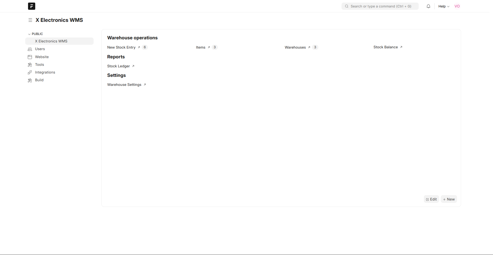
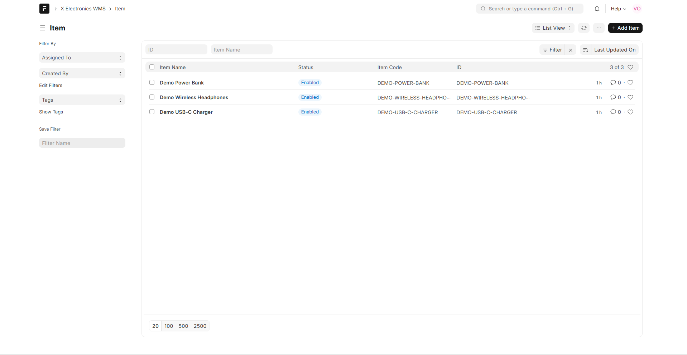
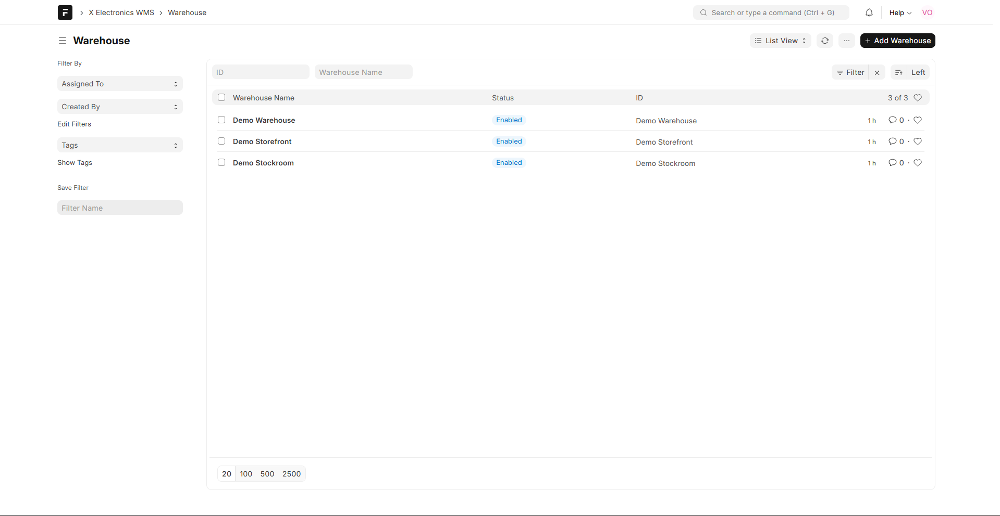
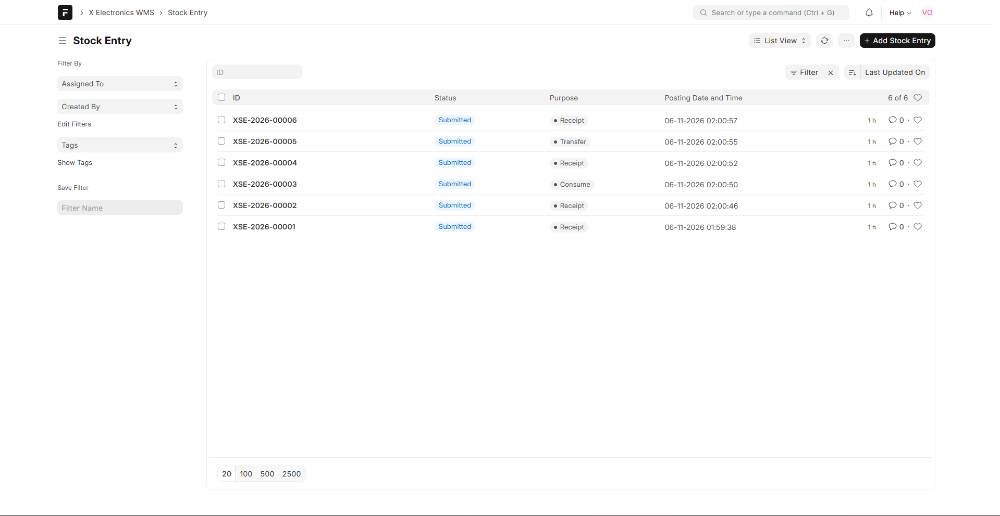
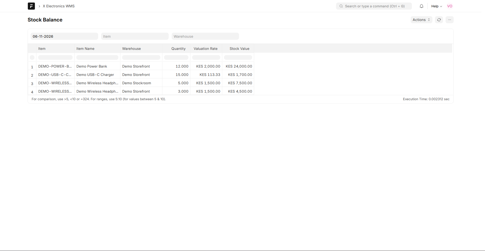
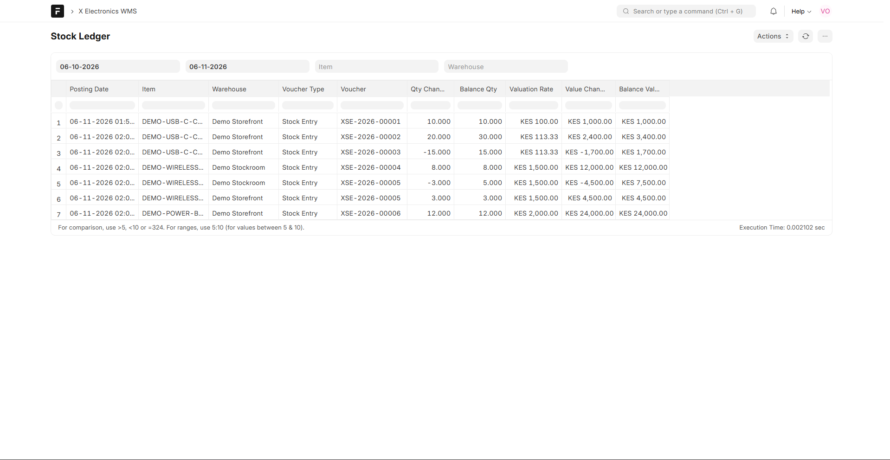
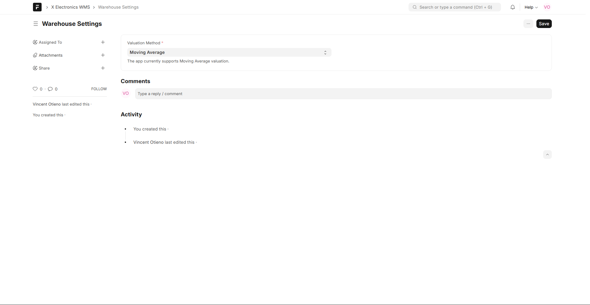

# X Electronics Warehouse

A standalone Frappe app for item and warehouse setup, submitted stock receipts, issues and transfers, a stateless stock ledger, and stock ledger/balance reports. It uses moving-average inventory valuation.

## Requirements and installation

On Windows, use WSL 2 with Ubuntu. From PowerShell, install WSL/Ubuntu if it is not already installed, restart if Windows requests it, then open Ubuntu once to finish its first-run account setup:

```powershell
wsl --install -d Ubuntu-24.04
```

From Ubuntu, change to the cloned project directory and run the bootstrap script:

```bash
cd /path/to/X-Electronics-Warehouse
bash env/setup_wsl.sh
```

The script installs the local development dependencies in Ubuntu, creates a bench at `~/frappe-bench`, creates a `warehouse.local` site, installs this app, and runs its tests. It keeps bench-managed Python packages inside the bench virtual environment; no project `env/` virtualenv is needed because Frappe Bench owns that environment. See [`env/README.md`](env/README.md) for details and rerun instructions.

To use an existing v15 bench instead, get the app into the bench and run:

```sh
bench --site your-site install-app x_electronics_warehouse
bench --site your-site migrate
bench --site your-site run-tests --app x_electronics_warehouse
```

## Stock model

Valuation is configured once for the app in the single-record `Warehouse Settings` DocType, linked from the **X Electronics WMS** workspace (`/app/x-electronics-wms`). The assessment build supports Moving Average only; Items do not have individual valuation methods.

`Stock Ledger Entry` is an immutable, non-submittable DocType: one row per item/warehouse movement. It stores signed quantity and value deltas plus the resulting balance and valuation rate. There is no mutable Bin or cached balance document; balances are derived by aggregating ledger rows.

`Stock Entry` is the user-facing submitted transaction. Receipt accepts quantity and unit cost, consume uses the current moving average, and transfer creates a paired outgoing/incoming ledger movement at the source warehouse's current moving average. All rows for one Stock Entry are inserted in one database transaction and the submitted document state prevents duplicate posting.

For a receipt, the new rate is `(prior stock value + received quantity * unit cost) / (prior quantity + received quantity)`. For an issue, the current rate is applied to the issued quantity. Negative stock is rejected. Backdated submissions are rejected because they would invalidate the stored running average; ledger rows are immutable and Stock Entry cancellation is blocked after posting. Correct mistakes with a compensating stock entry.

For a transfer between warehouses, each warehouse retains its own moving average. The source warehouse's carrying cost is used for the outgoing leg and incoming value at the destination; destination average is recalculated using its prior balance and the received transfer value.

The ledger balance calculation is one parameterized SQL aggregate over the relevant item/warehouse history (quantity and value deltas). Reports use Frappe query reports with parameterized filters.

## DocTypes and reports

- Item: SKU, description, and stock UOM.
- Warehouse Settings: app-wide valuation configuration (Moving Average).
- Warehouse: nested set tree with parent and group flags.
- Stock Ledger Entry: stateless immutable movement and running valuation snapshot.
- Stock Entry: receipt, consume or transfer with child item lines.
- Stock Ledger and Stock Balance: query reports.

The WMS workspace is named **X Electronics WMS** and lives at `/app/x-electronics-wms`. This keeps it separate from the **Warehouse** DocType route at `/app/warehouse`, so the Warehouses shortcut opens the warehouse tree/list instead of routing back to the workspace. Existing sites get this rename automatically when you run `bench migrate`.

## Screenshots

The screenshots below show the running WMS workspace, master data, stock transactions, reports, and valuation setting.

### WMS workspace



### Items



### Warehouses



### Stock entries



### Stock balance



### Stock ledger



### Warehouse settings



## Tests

The Frappe test module covers receipt/consume moving averages, the 10 @ 100 + 20 @ 120 then consume 15 example, transfer valuation, stock validation, and both report queries. Tests require a configured Frappe site and MariaDB/PostgreSQL backend supported by Frappe.
